# HW01 实用工具函数（Some Utility Functions）解析

在 NTU 机器学习（Spring 2023）HW01 疫情预测作业的 `ml2023spring-hw1-v1.ipynb`（Cell 10）中，定义了三个基础工具函数：
1. `same_seed(seed)`：全局伪随机数种子固定（实验可复现性保障）
2. `train_valid_split(data_set, valid_ratio, seed)`：确定性训练集与验证集切分
3. `predict(test_loader, model, device)`：标准深度学习测试集批量推理与格式导出

---

## 1. 源代码一览

```python
def same_seed(seed): 
    '''Fixes random number generator seeds for reproducibility.'''
    torch.backends.cudnn.deterministic = True
    torch.backends.cudnn.benchmark = False
    np.random.seed(seed)
    torch.manual_seed(seed)
    if torch.cuda.is_available():
        torch.cuda.manual_seed_all(seed)

def train_valid_split(data_set, valid_ratio, seed):
    '''Split provided training data into training set and validation set'''
    valid_set_size = int(valid_ratio * len(data_set)) 
    train_set_size = len(data_set) - valid_set_size
    train_set, valid_set = random_split(data_set, [train_set_size, valid_set_size], generator=torch.Generator().manual_seed(seed))
    return np.array(train_set), np.array(valid_set)

def predict(test_loader, model, device):
    model.eval() # Set your model to evaluation mode.
    preds = []
    for x in tqdm(test_loader):
        x = x.to(device)                        
        with torch.no_grad():                   
            pred = model(x)                     
            preds.append(pred.detach().cpu())   
    preds = torch.cat(preds, dim=0).numpy()  
    return preds
```

---

## 2. 辅助函数总览（简短函数速览）

对于功能单一、逻辑紧凑的模板化函数，在此直接汇总核心作用与实现细节，无需冗长展开：

### `same_seed(seed)`：全栈随机种子固定
用于消除随机性，保证模型权重初始化、数据采样及 CUDA 算子运行结果完全可复现（作业默认 `seed=5201314`）：
- **CuDNN 确定性**：`torch.backends.cudnn.deterministic = True` 强制选用确定性算法；`benchmark = False` 关闭基准性能动态搜寻，避免硬件负载或输入尺寸波动引起算子变更。
- **NumPy 全局种子**：`np.random.seed(seed)` 控制 NumPy 数组随机洗牌与数据探索阶段的随机状态。
- **PyTorch CPU 种子**：`torch.manual_seed(seed)` 控制 CPU 上的权重初始化（如 `nn.Linear` 的 Kaiming 均匀分布）和随机采样。
- **PyTorch GPU 种子**：`torch.cuda.manual_seed_all(seed)` 在 CUDA 可用时为当前可见的所有 GPU 设备统一种子，控制 `nn.Dropout` 掩码随机置零及 GPU 端张量初始化。

### `train_valid_split(data_set, valid_ratio, seed)`：独立隔离数据集切分
将输入的完整数据集 `data_set`（如 `(3009, 89)`）按比例（如 `0.2`）切分为训练集与验证集：
- **边界防漏计数**：验证集大小取整 `valid_set_size = int(valid_ratio * len(data_set))`（601）；训练集大小采用总数相减 `train_set_size = len(data_set) - valid_set_size`（2408），避免两次浮点数截断导致总样本数丢失 1 的隐蔽 Bug。
- **局部隔离生成器**：传入显式的 `generator=torch.Generator().manual_seed(seed)`，创建专属的局部随机数生成器，保证切分逻辑与全局随机数状态完全解耦，切分结果严格恒定。
- **格式返回**：将 `random_split` 产出的 `Subset` 对象转回原生 `np.array`，便于后续按列索引切分特征与目标。

---

## 3. 核心函数重点剖析：`predict(test_loader, model, device)`

`predict` 承担无标签测试集的批量推理，是工业级 PyTorch 推理的标准实现范式。其核心在于**状态控制**、**显存安全**与**张量生命周期管理**，重点关注以下三个阶段：

### 阶段一：模式与计算图控制
- **`model.eval()`**：将模型切换至评估模式。
  - 冻结 `nn.Dropout`（所有神经元权重以全概率传递，不再随机置零）；
  - 锁定 `nn.BatchNorm1d`（使用训练期间累积的全局均值与方差，停止按批次计算均值方差）。
- **`with torch.no_grad():`**：关闭自动求导引擎。
  - 推理不需要反向传播，此上下文管理器会彻底停止构建动态计算图（Computation Graph），不缓存中间激活值，大幅降低 GPU 显存开销并提升推理吞吐速度。

### 阶段二：逐批推理与显存安全回收
- **`x = x.to(device)`**：将批次张量从系统内存搬移到指定的推理设备（如 GPU 显存），保证输入与模型权重驻留同一硬件。
- **`pred = model(x)`**：前向计算输出预测结果，形状由输入 $x \in \mathbb{R}^{B \times 88}$ 映射为 $\text{pred} \in \mathbb{R}^{B}$。
- **`preds.append(pred.detach().cpu())`（显存回收黄金法则）**：
  - `.detach()`：显式切断预测张量与计算图的一切关联（虽处于 `no_grad()` 下，显式 `detach()` 仍是双重安全保障）；
  - `.cpu()`：**立即将张量从 GPU 显存拷贝回主机内存（RAM）**。若直接将 GPU 张量暂存在 Python 列表中，会造成 GPU 显存持续累积直至 OOM；此外，NumPy 无法直接读取 GPU 内存中的张量，必须先回迁到 CPU。

### 阶段三：张量聚合与格式导出
- **`preds = torch.cat(preds, dim=0).numpy()`**：
  - `torch.cat(preds, dim=0)` 将各批次的一维张量沿第 0 维串联成长度为 997 的连续一维张量；
  - `.numpy()` 转换为标准 NumPy `ndarray` 数组，直接交付下游 `save_pred()` 写入 CSV 文件。

---

## 4. 全局数据流与硬件流转

```mermaid
flowchart TD
    subgraph Reproducibility [可复现性保障: same_seed]
        Seed[seed: 5201314] --> CuDNN[CuDNN deterministic=True, benchmark=False]
        Seed --> NP[np.random.seed]
        Seed --> CPU[torch.manual_seed]
        Seed --> GPU[torch.cuda.manual_seed_all]
    end

    subgraph Split [数据切分: train_valid_split]
        RawData["train_data (3009, 89)"]
        G[torch.Generator.manual_seed]
        RawData --> RS["random_split(ratio=0.2)"]
        G -.局部隔离.-> RS
        RS --> Train["train_set: (2408, 89)"]
        RS --> Valid["valid_set: (601, 89)"]
    end

    subgraph Inference [推理流转: predict]
        TestLoader["test_loader (997 样本 / batch=256)"]
        TestLoader --> Batch["x: (B, 88) [CPU RAM]"]
        Batch --> HostToDevice["x.to(device)"]
        HostToDevice --> Forward["model(x) under eval() + no_grad()"]
        Forward --> PredBatch["pred: (B,) [GPU VRAM]"]
        PredBatch --> DetachCPU["pred.detach().cpu() [回迁 CPU RAM]"]
        DetachCPU --> ListAccum["preds 列表暂存"]
        ListAccum --> Cat["torch.cat(preds, dim=0) -> (997,)"]
        Cat --> ToNumpy["preds.numpy() -> ndarray (997,)"]
    end
```



---

## 5. 核心避坑要点

1. **测试集 DataLoader 必须保持 `shuffle=False`**：测试集无标签，下游 `save_pred()` 依赖样本原始顺序生成预测序号 `id`。一旦打乱，预测结果与真实标签完全错位。
2. **`eval()` 与 `no_grad()` 缺一不可**：`eval()` 管的是网络层的前向计算行为（Dropout/BN），`no_grad()` 管的是梯度计算图与显存分配，两者定位完全不同、互不替代。
3. **`detach().cpu()` 顺序与时机**：长循环批次推理中，必须在每轮迭代内将预测结果移回 CPU，严禁在 GPU 显存内长期累积张量列表。
